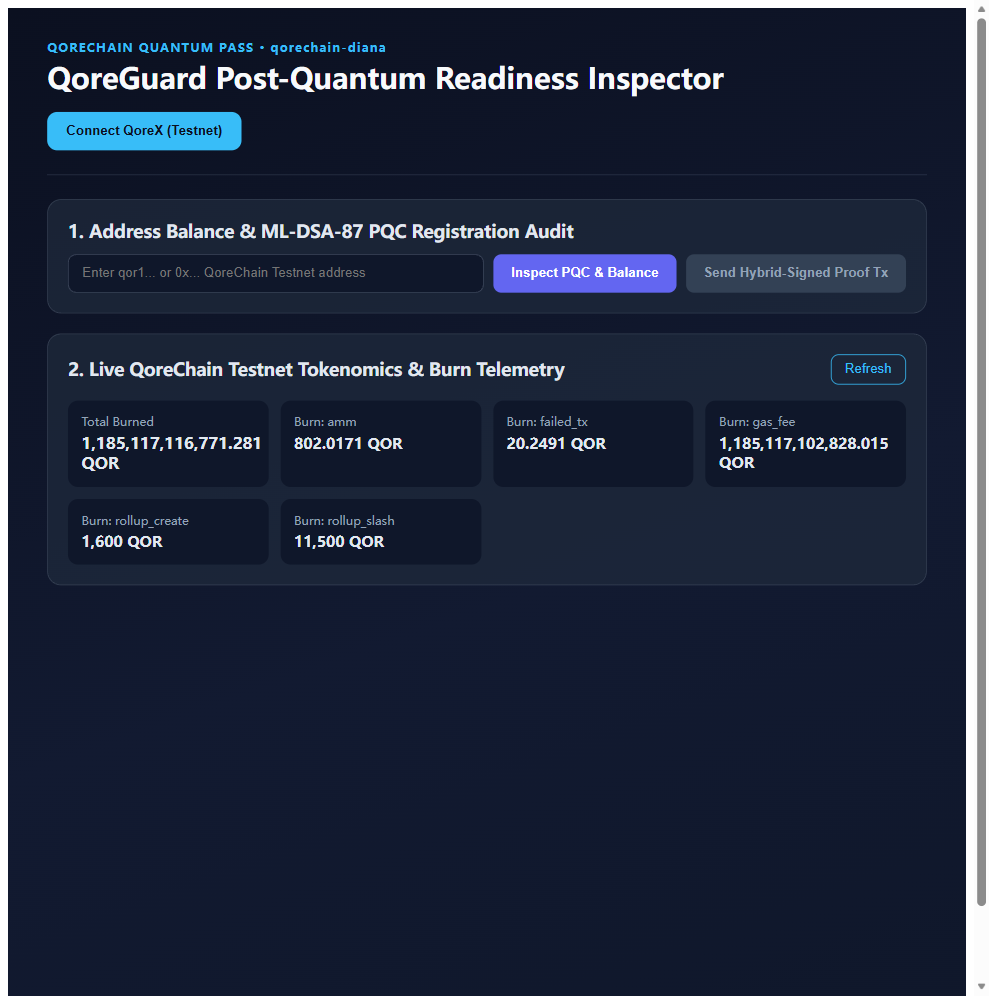

# QoreGuard Quantum Pass

Post-Quantum Readiness Inspector & Hybrid-Signed Proof dApp built for **Build Before Q-Day: The QoreChain Developer Fest** (`Quantum Pass` track).

- **Live Demo**: https://devbox-zero-ops.github.io/qoreguard-quantum-pass/



## Features

- **QoreX Wallet Integration**: Detects and connects QoreX on `qorechain-diana` testnet.
- **ML-DSA-87 PQC Readiness Audit**: Queries `qor_getPQCKeyStatus`, REST PQC account records, and native `QOR` balances for any `qor1...` or `0x...` address.
- **Hybrid-Signed Proof Transaction**: Dispatches a hybrid-signed self-check transaction (`qor_sendTransaction`) directly through QoreX.
- **Live Testnet Tokenomics Telemetry**: Reads `qor_getTokenomicsOverview` directly from QoreChain testnet RPC with downloadable JSON audit reports.

## Quickstart

```bash
npm install
npm run build
npm run dev
```

## Credits & Open-Source Attributions

- Scaffolded with [`create-qorechain-dapp`](https://build.qorechain.io/kits) (`fullstack-web` template).
- Powered by [`@qorechain/sdk`](https://www.npmjs.com/package/@qorechain/sdk) (`createClient`, `qor_getPQCKeyStatus`, `qor_getTokenomicsOverview`).
- Built with React 18, TypeScript, and Vite.

## License

MIT — see [LICENSE](./LICENSE).

## Verified Testnet Transactions (`qorechain-diana`)

- **ML-DSA-87 Key Registration (`MsgRegisterPQCKeyV2`)**: `9EA9E9F491A478C390F3B50EE71CE1A73B9788BC3FD3455E77D9FCD1DCE0C9E2` (Block `10814705`)
- **Hybrid-Signed Proof Transaction (`MsgSend`, 1 `uqor`)**: `9BBF4541A77802CF8377F7C24037F1BE439A80DC6807947F434790D93A081326` (Block `10814708`)
